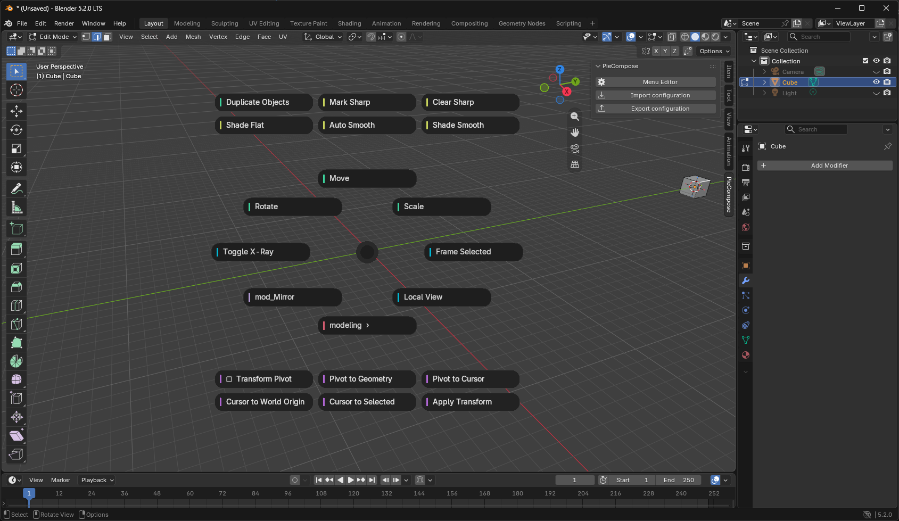
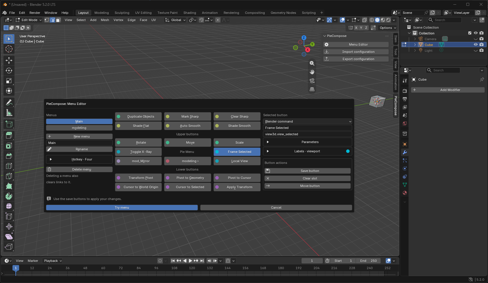

# PieCompose


Build your own pie menus. Run Blender commands with a flick.
Current version: **0.1.12**, tested with **Blender 5.2 LTS**.



## Features

- Eight fixed radial directions with additional button groups.
- Submenu links and per-menu keyboard shortcuts.
- Colored labels for organization and quick recognition.
- Right-click a supported Blender operator button and choose `Add to PieCompose`.
- Create a button with a single key combination such as Ctrl+B or by entering an operator name.
- Capture writable checkboxes through Blender RNA, including settings for the active object or material, the scene or world, the viewport, and nested settings.
- Select slots visually and move or swap buttons in the menu editor.
- Rename or recolor a label across all buttons that use it, or remove it from all buttons at once by deleting it.
- One configuration file for menus, commands, labels and shortcuts.



## Installation

1. Download `piecompose-<version>.zip` from [Releases](https://github.com/litrk/piecompose/releases). Choose the add-on ZIP, not GitHub's automatic source code archives.
2. In Blender, open Edit → Preferences → Get Extensions → menu → Install from Disk.
3. Select the downloaded ZIP and enable PieCompose.

Open N → PieCompose → Menu Editor in the 3D Viewport, or search for
`PieCompose: Menu Editor` with F3. A fresh installation starts with one empty
`New menu`, no labels and no assigned shortcuts. Add commands and assign a
shortcut in the editor. Existing configurations are kept when reinstalling.
Select commands with pointer gestures or clicks; numeric sector hints and
NumPad sector selection are not used.

Do not load the development prototype and the installed extension in the same
Blender session. Restart Blender before switching between them.

## Updating

Use Install from Disk again for a newer version. Menus, commands,
labels and shortcuts stay in the same user configuration directory. Updating
does not reset them. If an existing configuration cannot be read, enabling the
add-on reports an error and leaves the file untouched.

## Configuration

To create a shortcut button, select a slot, choose `Keyboard shortcut`, click
the event field and press Ctrl+B (or another single combination), then click
`Save button`. A blank name defaults to the combination. This is separate from
the menu's own Hotkey. The button resolves the current Blender keymap command
and its parameters when clicked: Ctrl+B uses Bevel in Mesh Edit Mode. It follows
keymap changes and the active mode/tool; if no available command matches, it
reports that. Repeated sequences such as GG are not supported. This looks up and
invokes a command; it does not simulate physical keyboard input.

For manual commands, `mesh.bevel`, `bpy.ops.mesh.bevel` and an empty trailing
`()` are accepted. Put arguments in Parameters JSON; Python code is not evaluated.

The editor and Add to PieCompose dialog remember the last selected editing menu
for the current Blender session. Repeated captures default to that menu; if it
was deleted or replaced, the first available menu is selected instead.

While editing, selecting an unlabelled button keeps the current label choice
ready for reuse. A labelled button shows its own label. Click Assign label to
apply it; selecting a button never assigns a color automatically.

Checkbox buttons follow the active context, rather than the object used during
capture. For example, In Front affects the active object and a modifier checkbox
affects its active modifier. Collections without an active member retain their
RNA member key. Missing, incompatible or read-only targets report that the action
is unavailable. Numeric fields, Boolean arrays and enum controls are separate
from scalar checkbox capture.

Use `Import configuration` and `Export configuration` in N → PieCompose to
transfer menus, labels and shortcuts together. Importing creates a backup of
the previous configuration. Prototype configuration files remain compatible.

The installed extension stores its configuration under Blender's user CONFIG
directory in `piecompose/pie-menus.json`, outside the add-on code.
Personal configurations and generated archives are excluded from this repository.

## Development

The canonical source is in `piecompose/`. The root `pie_prototype.py` and
`pie_data.py` files are compatibility entry points for development and tests.
`launch_blender.ps1` opens the development version on Windows.

Build and validate the extension with Blender's native extension tools:

```powershell
python scripts/build_extension.py
```

For a different Blender executable:

```powershell
python scripts/build_extension.py --blender "C:/path/to/blender.exe"
```

Run model tests and installation/restart checks:

```powershell
python -m unittest discover -s tests -v
python tests/run_extension_lifecycle.py
```

Blender integration and UI tests are in `tests/`. Use a temporary
`PIE_MENU_DATA_PATH` for isolated configuration tests. The installation lifecycle
test creates its own temporary Blender profile. See `REGRESSION.md` for gesture
regression checks and `extension-qa.md` for the initial release checks.

## License

GPL-3.0-or-later. See [LICENSE.txt](piecompose/LICENSE.txt).

PieCompose was developed using Codex.
